<picture>
  <source media="(prefers-color-scheme: dark)" srcset="./dark.svg" />
  <source media="(prefers-color-scheme: light)" srcset="./light.svg" />
  
</picture>

## `$ whoami`

Soy **Karla Dedios**, estudiante de **Ingeniería en Computación e Informática** en la **Universidad Andrés Bello**, Chile. Busco mi primera práctica profesional en TI, con interés en **ciberseguridad**, **desarrollo de software** y **redes**.

## `$ cat stack.txt`

- **Lenguajes:** Java, JavaScript, HTML y CSS; Python (en aprendizaje mediante proyectos).
- **Desarrollo:** React, Node.js y Java Swing.
- **Bases de datos:** MySQL, MongoDB.
- **Sistemas y redes:** Linux, Windows, conceptos de redes TCP/IP.
- **Herramientas:** Git, GitHub, Bash, Apache NetBeans.
- **Seguridad:** laboratorios de TryHackMe y DVWA; en preparación para ISC2 Certified in Cybersecurity (CC) (*aún no obtenida*).

## `$ ls projects/ --featured`

Aplicación de productividad académica con gestión de tareas, calendario, temporizador Pomodoro, estadísticas y modo claro/oscuro.

 &nbsp; 

Analiza registros de autenticación SSH, cuenta accesos fallidos y exitosos, agrupa eventos por IP y genera informes JSON. Incluye pruebas unitarias y registros ficticios.

 &nbsp; 

Comprobación de disponibilidad de servicios TCP indicados explícitamente, tiempos de respuesta e informes JSON. Incluye pruebas con conexiones simuladas, sin tráfico real en los tests.

 &nbsp; 

App comunitaria de mascotas con mapa social y funciones de paseos y alertas en fase beta. **Repositorio privado**; funcionalidades para usuarios reales todavía en desarrollo.

### Otros proyectos académicos

| Proyecto | Tecnologías / contribución |
| --- | --- |
| **Sabores Urbanos** | React, Node.js, MongoDB; módulos de clientes y mesas en un sistema de restaurante grupal. |
| **Gestión de gimnasio** | Aplicación de escritorio con Java Swing y base de datos MySQL. |

## `$ git stats --profile`

Las tarjetas dependen de un servicio externo y pueden no cargarse temporalmente. Los lenguajes reflejan el código disponible en los repositorios, no el nivel de dominio.

## `$ locale --languages`

Español (nativo) · Coreano (fluido) · Inglés (avanzado)

## `$ contact`

  &nbsp;&nbsp;&nbsp;
  &nbsp;&nbsp;&nbsp;
  

